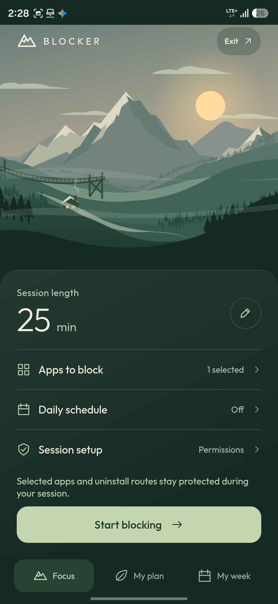
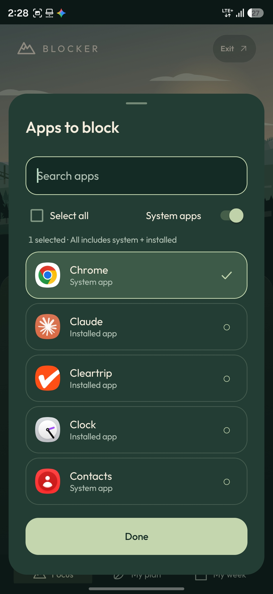
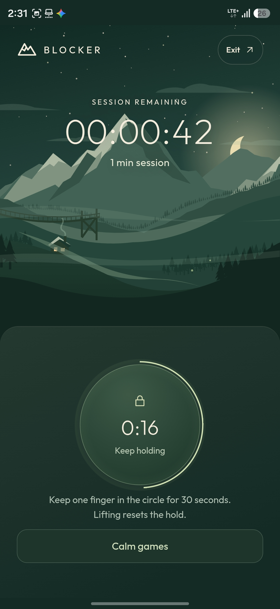
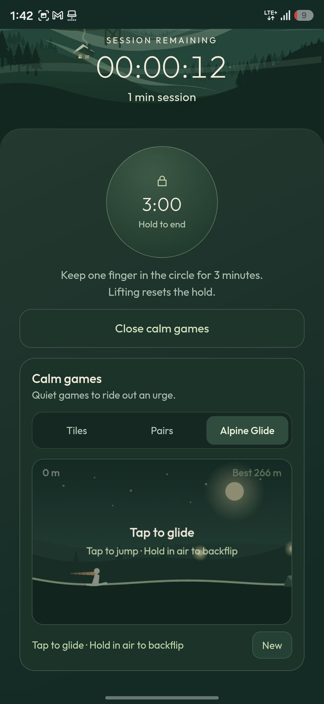
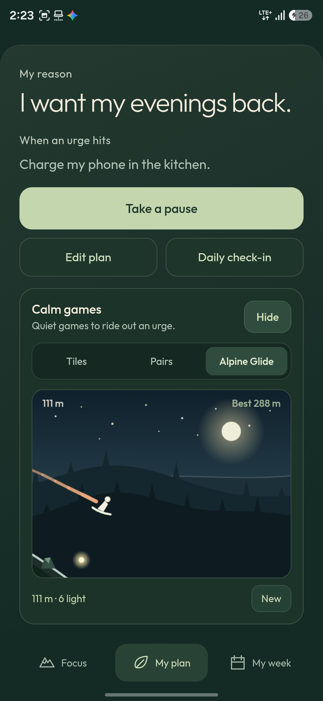
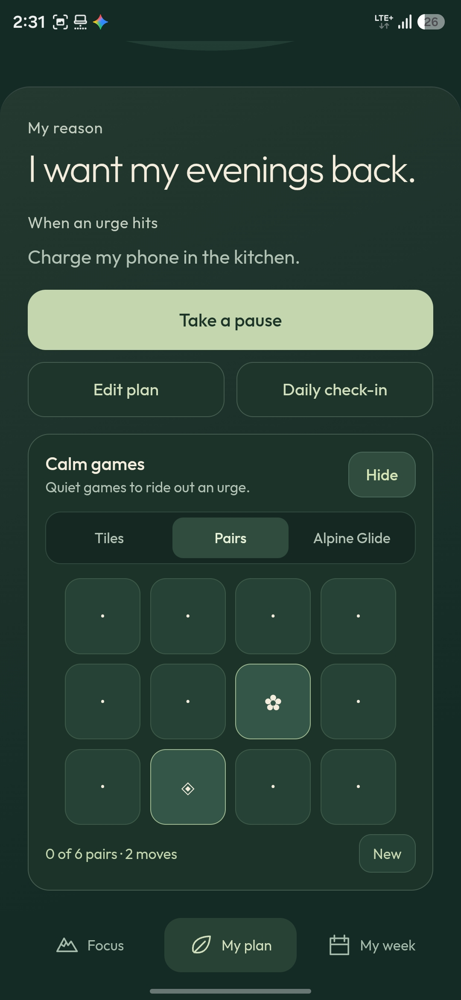
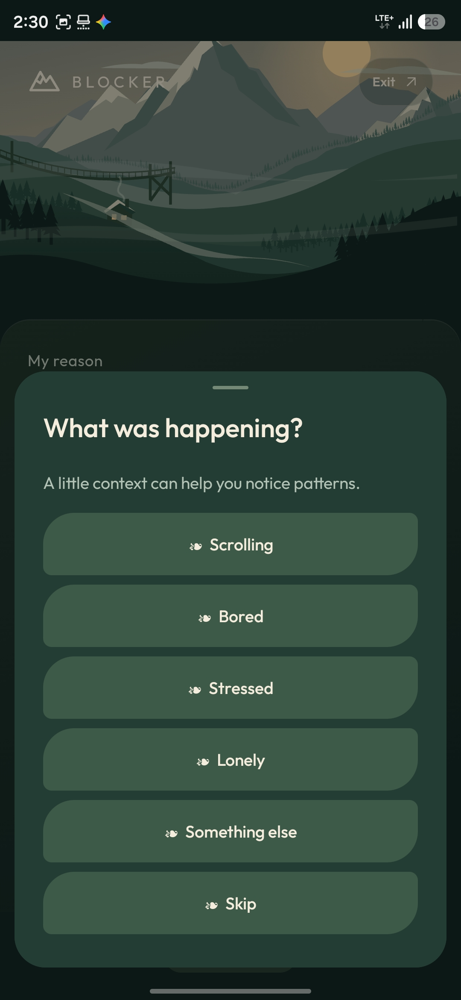
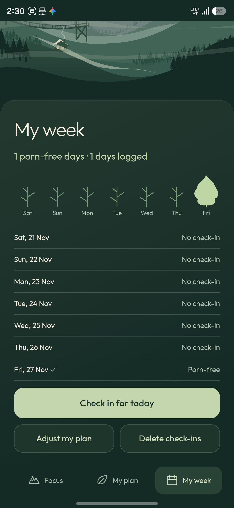

# BLOCKER for Android

BLOCKER is a personal focus timer for Android 8 and later. Choose the apps you want to pause, set a session length, and start the timer. During a session, BLOCKER detects when a selected app is in the foreground and shows a blocking screen. To end a session early, hold the on-screen control for the configured duration.

## Downloads

[Download BLOCKER 5.5.1 for Android](https://github.com/Karthik5006/BLOCKER/raw/eea535228f263cf7e4ad3fab66fd80e95458474f/releases/5.5.1/BLOCKER-5.5.1-final11.apk)

The latest download is revision 11 of version 5.5.1. [Earlier BLOCKER 5.4 APK](releases/5.4/BLOCKER.apk?raw=1)

## Screenshots

<p align="center">
  
  
  
  
</p>
<p align="center">
  
  
  
  
</p>

## Android permissions and banking apps

This version uses Usage Access, Display over other apps, and a foreground service. On a personal phone, setup also requests device administrator access. During a session, the app can intercept system screens for app management and administrator deactivation. The APK declares no accessibility service. Compatibility with HSBC, ICICI, and other banking apps requires testing on the device.

## Build and verification

Use the [source for the latest APK](https://github.com/Karthik5006/BLOCKER/tree/eea535228f263cf7e4ad3fab66fd80e95458474f) with JDK 17 or 21, Android SDK Platform 35, and Build Tools 35.0.0.

```sh
python3 tools/build.py --sdk /path/to/Android/Sdk
./gradlew testDebugUnitTest
```

The build writes `app/build/outputs/apk/personal/BLOCKER.apk`. It uses the local signing key in `signing/personal-debug.keystore` and creates one if needed. Android requires the same signing key for in-place updates.

The latest APK was built from the supplied source and signed with the local personal test key. Its signing certificate differs from revision 7. Switching from revision 7 requires a fresh install, which clears local app data. Optional notification access lets BLOCKER snooze notifications from selected apps for the remaining session time.

Published APK SHA-256: `c53dd05a0c54a0d8ce8e8b4a62926511bd9bcc825071ef0c341c2e585b970b7b`.
